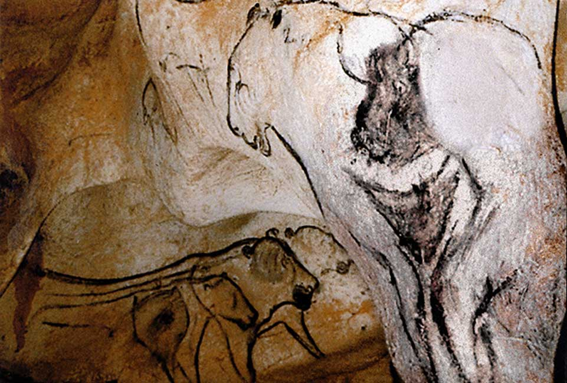

+++
title = 'South African Rock Art'
date = 2023-02-15T10:00:00-07:00
draft = false
tags = ['historical']
series = 'Rock Art'
thumbnail = 'The-Sorcerer.jpg'
+++

Southern Africa holds one of the richest collections of rock art in the world. Tens of thousands of paintings and engravings survive in rock shelters and on open boulders, from the Cederberg in the west to the Drakensberg in the east. Most of them were made by the ancestors of the San, the hunter-gatherers who have lived in the region for thousands of years.

### How old is it?

The tradition reaches very deep into the past. A piece of ochre engraved with a cross-hatched pattern at **Blombos Cave**, on the southern Cape coast, is about 75,000 years old, and painted stone slabs from **Apollo 11 Cave** in neighbouring Namibia date to around 27,000 years ago. Most of the paintings we can still see today are far younger, however — the majority were made within the last few thousand years, and some show horses, wagons and men with guns, which means they were painted after European settlers arrived.

The **uKhahlamba-Drakensberg Park**, a UNESCO World Heritage Site, alone holds around 600 sites with more than 35,000 individual images. The painters used ochre for reds and yellows, charcoal and manganese for black and white clay for white, mixed with binders such as animal fat or blood.

### What do the paintings show?

At first glance, much of the art looks like a record of daily life: hunters with bows, groups of dancers and, above all, animals. The **eland**, the largest antelope in Africa, is painted more often and in more detail than any other animal. Scholars long read these images as simple scenes of hunting and food.

That changed in the 1970s and 1980s, when the archaeologist **David Lewis-Williams** compared the paintings with 19th-century accounts recorded from /Xam San people by Wilhelm Bleek and Lucy Lloyd, and with the testimony of San living in the Kalahari. He argued that much of the art is religious: it shows what shamans experienced in trance, when they entered the spirit world to heal the sick, make rain and control game.

Read this way, details that once looked odd fall into place. Dancers bend forward with their arms stretched behind them, a posture still used in San trance dances. Figures bleed from the nose, as dancers do in deep trance. Dying eland — which the San associated with potent spiritual power — appear beside people who share their features. I write more about these states of mind in [Between Worlds](/posts/between-worlds).

### Part human, part animal

Some of the most striking figures are **therianthropes**: beings that are part human and part animal. At **Game Pass Shelter** in the Drakensberg, a dying eland stumbles with crossed legs while a figure holding its tail has hooves in place of feet. The panel is so central to the trance interpretation that it is often called the "Rosetta Stone" of San art: the shaman, like the dying eland, is entering another world.

Similar figures appear in the Upper Palaeolithic caves of Europe, made by people with no contact with southern Africa, tens of thousands of years earlier.

The best known is "the Sorcerer" of the Trois-Frères cave in France, a figure with antlers, an owl-like face and human legs. Whether such figures show shamans, spirits or something else entirely is still debated, but the parallel suggests that part of what we see in rock art is rooted in human experience shared across continents.

### Why it matters

San rock art is one of the longest artistic traditions humans have produced, and one of the few where descendants of the artists could still explain what the images meant. It is also fragile: paintings fade in sunlight, wash away in rain and are damaged by visitors who wet them to make the colours brighter. If you visit a site, look, photograph — and never touch.
