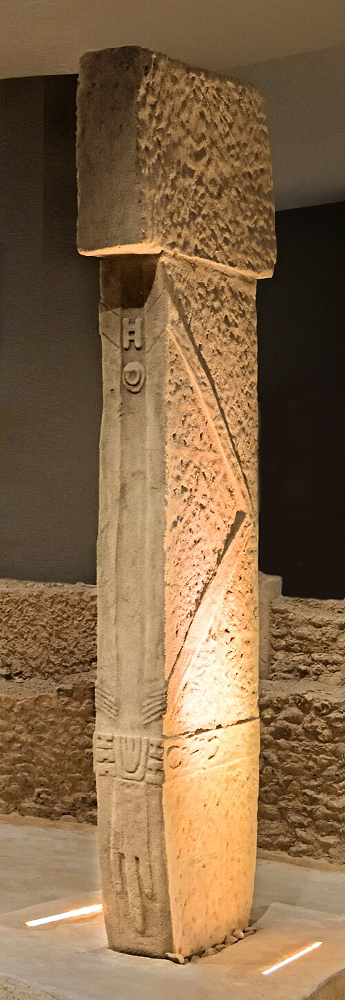

+++
title = 'Painted Visions: Reading the Rock Art of the San'
date = 2024-11-11T20:00:00+01:00
draft = false
tags = ['historical', 'trance']
series = 'Rock Art'
thumbnail = 'The-Sorcerer.jpg'
+++

Southern Africa holds one of the richest collections of rock art in the world. Tens of thousands of paintings and engravings survive in rock shelters and on open boulders, from the Cederberg in the west to the Drakensberg in the east. Most of them were made by the ancestors of the San, the hunter-gatherers who have lived in the region for thousands of years.

The paintings matter beyond southern Africa. For a long time nobody knew how to read rock art anywhere. The San tradition is unusual because, in the 19th century, a handful of San men gave detailed explanations of what such images meant, and someone wrote them down.

## How old is it?

The tradition reaches very deep into the past. A piece of ochre engraved with a cross-hatched pattern at **Blombos Cave**, on the southern Cape coast, is about 75,000 years old, and painted stone slabs from **Apollo 11 Cave** in neighbouring Namibia date to around 27,000 years ago. Most of the paintings we can still see today are far younger, however — the majority were made within the last few thousand years, and some show horses, wagons and men with guns, which means they were painted after European settlers arrived.

The **uKhahlamba-Drakensberg Park**, a UNESCO World Heritage Site, alone holds around 600 sites with more than 35,000 individual images. The painters used ochre for reds and yellows, charcoal and manganese for black and white clay for white, mixed with binders such as animal fat or blood.

## What do the paintings show?

At first glance, much of the art looks like a record of daily life: hunters with bows, groups of dancers and, above all, animals. The **eland**, the largest antelope in Africa, is painted more often and in more detail than any other animal. Scholars long read these images as simple scenes of hunting and food.

That changed in the 1970s and 1980s, when the archaeologist **David Lewis-Williams** compared the paintings with 19th-century accounts recorded from /Xam San people, and with the testimony of San living in the Kalahari. He argued that much of the art is religious: it shows what shamans experienced in trance, when they entered the spirit world to heal the sick, make rain and control game.[^1]

## In Their Own Words

Those 19th-century accounts exist because of the German philologist **Wilhelm Bleek**, who arrived in the Cape in 1855 intending to study Bantu languages and turned instead to the click languages of the San. He and his sister-in-law **Lucy Lloyd**, later joined by his daughter **Dorothea Bleek**, worked with /Xam men who had been imprisoned in Cape Town and were then lodged in the Bleek household. Among them were **Diä!kwain** and **//Kabbo**, whose words fill thousands of pages.[^2]

")

Copies of rock paintings made by amateur explorers such as **Joseph Millard Orpen** and **George William Stow** were shown to the informants, who explained them. One of Lloyd's notes records Diä!kwain looking at a line of dancing figures:

> They seem to be dancing, for they stand stamping (?) with their legs. This man who stands in front seems to be showing the people how to dance.
{caption="— Diä!kwain, recorded by Lucy Lloyd in 1875"}

He went on to say that the leader dances first because he is a great sorcerer, and that those learning dance after him.[^3] The word Lloyd wrote as "sorcerer" really means an owner of supernatural potency, and the dance is the trance dance. I follow both in [Between Worlds](/posts/between-worlds).

The archive has a sad context. The San of the Drakensberg were driven from their land by colonists in the 19th century, and their rock-painting tradition ended there. San communities survive in the Kalahari, but they do not paint on rock shelters. The notebooks are therefore one of the few ways left to hear the painters' descendants.

## Reading the paintings

Read with the notebooks in hand, details that once looked odd fall into place. Dancers bend forward with their arms stretched behind them, a posture still used in San trance dances. Figures bleed from the nose, as dancers do in deep trance. One figure has an eland's head and a bleeding nose, with lines that may be sweat from the armpits, which healers rubbed onto the sick. Another has sickness leaving the back of its neck, something only shamans could see. Dying eland, which the San associated with potent spiritual power, appear beside people who share their features.

## Part human, part animal

Some of the most striking figures are **therianthropes**: beings that are part human and part animal. At **Game Pass Shelter** in the Drakensberg, a dying eland stumbles with crossed legs while a figure holding its tail has hooves in place of feet. The panel is so central to the trance interpretation that it is often called the "Rosetta Stone" of San art: the shaman, like the dying eland, is entering another world.

Similar figures appear in the Upper Palaeolithic caves of Europe, made by people with no contact with southern Africa, tens of thousands of years earlier.

The best known is "the Sorcerer" of the Trois-Frères cave in France, a figure with antlers, an owl-like face and human legs. Whether such figures show shamans, spirits or something else entirely is still debated, but the parallel suggests that part of what we see in rock art is rooted in human experience shared across continents.

## From the Drakensberg to the First Temples

If the San key works in southern Africa, how far can it reach? The strangest test case is the Shaft scene at **Lascaux** in France, painted roughly 17,000 years ago in a deep, awkward recess of the cave. A bison stands with its belly open and its entrails hanging out. In front of it a man with a bird's head lies, or falls, rigid. Beside him is a bird on top of a pole. Human figures are rare in Palaeolithic cave art, which makes this one all the more puzzling.[^4]

Two readings have dominated. One treats it as a hunting scene, in which a man has wounded a bison and been gored for it. The other, going back to **Henri Breuil** and later popularised by **Joseph Campbell**, sees a shaman in trance, with the bird on its pole as a spirit helper. Read with the San in mind, a rigid figure who has "died" beside a dying animal looks very familiar.

The same question reaches architecture. **Göbekli Tepe** in south-eastern Turkey, excavated from 1995 by the German archaeologist **Klaus Schmidt**, is a set of circular enclosures of T-shaped limestone pillars raised around 9500 BCE by people who, as far as we know, had not yet adopted farming.[^5] The pillars are carved with foxes, snakes and vultures, and the two tall central pillars of Enclosure D have arms, hands and a belt, so they are read as stylised human, perhaps ancestral or divine, figures. The site is about 7,000 years older than the Great Pyramid.

The older story was that agriculture came first, and that monuments and organised religion followed from settled surplus. Göbekli Tepe strains that order: some of the earliest large-scale cooperation we can see was aimed at the unseen world, not at houses or defence.

Caution is still needed. The surviving San paintings are far younger than Lascaux, and nobody knows what was done at Göbekli Tepe. The analogy is an argument, not a proof. But a good key does not need to be perfect to change what we see, and the San notebooks are the best key rock art has. For the long road to accepting such deep time at all, see [The Age of Earth](/posts/age-of-earth).

## Conclusion

San rock art is one of the longest artistic traditions humans have produced, and one of the few where descendants of the artists could still explain what the images meant. That is what makes it so valuable. Without the notebooks, the eland, the bleeding noses and the hoofed figure at Game Pass would be pictures we could only guess at. With them, they become records of the dance, of potency and of the journey into the spirit world. And once we have learned to read them, it is hard to look at the bird-headed man at Lascaux or the carved pillars of Göbekli Tepe in quite the same way.

The paintings themselves are fragile. They fade in sunlight, wash away in rain and are damaged by visitors who wet them to make the colours brighter. If you visit a site, look, photograph — and never touch.

[^1]: David Lewis-Williams and Sam Challis, _Deciphering Ancient Minds: The Mystery of San Bushman Rock Art_ (Thames & Hudson, 2011).
[^2]: "Wilhelm Bleek", Wikipedia, [en.wikipedia.org/wiki/Wilhelm_Bleek](https://en.wikipedia.org/wiki/Wilhelm_Bleek); the Bleek and Lloyd collection is digitised by the University of Cape Town at [digitalbleeklloyd.uct.ac.za](https://digitalbleeklloyd.uct.ac.za/).
[^3]: Diä!kwain commented in 1875 on copies made by George William Stow; the question mark in brackets is Lucy Lloyd's, who was unsure of the word "stamping". See Lewis-Williams and Challis, _Deciphering Ancient Minds_.
[^4]: "Lascaux", Wikipedia, [en.wikipedia.org/wiki/Lascaux](https://en.wikipedia.org/wiki/Lascaux).
[^5]: Klaus Schmidt, _Göbekli Tepe: A Stone Age Sanctuary in South-Eastern Anatolia_ (2012); see also "Göbekli Tepe", Wikipedia, [en.wikipedia.org/wiki/Göbekli_Tepe](https://en.wikipedia.org/wiki/G%C3%B6bekli_Tepe).
