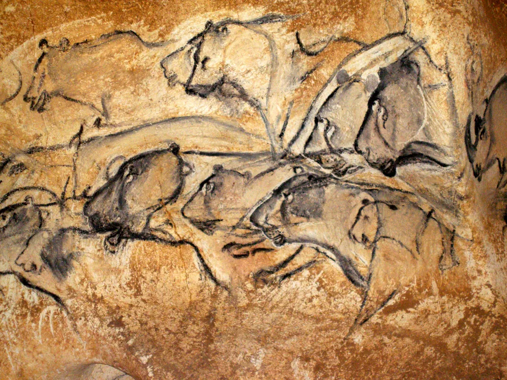

+++
title = 'Starost Zemlje: rođenje geologije'
date = 2024-11-11T18:40:03+01:00
draft = false
tags = ['povijest']
series = 'Umjetnost na stijenama'
thumbnail = 'apr2015_h07_chauvetcave.webp'
+++

Priča o starosti Zemlje fascinantno je putovanje kroz vrijeme u kojem se isprepliću mitologija, znanstveno istraživanje i revolucionarne ideje. Počinje s Jamesom Ussherom, irskim nadbiskupom iz 17. stoljeća, koji je slavno izračunao da je Zemlja stvorena **4004. godine pr. Kr.**, oslanjajući se na Bibliju kao glavni izvor. U to su se vrijeme mitološki i religijski tekstovi često smatrali mjerodavnim vodičima kroz povijest svijeta, pa je Ussherov zaključak bio široko prihvaćen.

> Prema Ussheru, stvaranje svemira dogodilo se „na početku noći koja je prethodila 23. listopada… godine 4004. prije Krista”
{caption="— James Ussher"}

### Od mitologije prema znanosti

Kako je znanstvena revolucija jačala, oslanjanje na mitologiju počelo je slabiti. Jedna od ključnih prekretnica u geologiji bio je rad **Jamesa Huttona**, škotskog geologa s kraja 18. stoljeća. Hutton je postavio **teoriju Zemlje** prema kojoj je Zemlja mnogo starija nego što se dotad vjerovalo. Uveo je pojam **uniformitarizma**, ideju da su geološki procesi na Zemlji postupni i ujednačeni kroz vrijeme. Prema Huttonu, sadašnjost je ključ za razumijevanje prošlosti — ta je ideja dovela u pitanje prevladavajuću biblijsku kronologiju i postavila temelje moderne geologije.

Bilo bi mi drago da odvojite vrijeme i pogledate ovaj video:



Ipak, nisu se svi rani geolozi slagali s tom idejom. Teorija **katastrofizma**, prema kojoj su obilježja Zemlje oblikovali nagli, nasilni događaji (poput Noina potopa), još je neko vrijeme ostala popularna. **Charles Lyell**, engleski geolog, dodatno je razradio Huttonove ideje u svojem prijelomnom djelu _Načela geologije_ (_Principles of Geology_, 1830.–1833.)[^1]. Lyell se snažno zalagao za uniformitarizam, tvrdeći da su procesi koje danas opažamo, poput erozije i taloženja, oblikovali Zemlju tijekom golemih vremenskih razdoblja.

### Charles Darwin i evolucija

U 19. stoljeću rad **Charlesa Darwina** dodao je novi sloj razumijevanju povijesti Zemlje. Darwinova temeljna knjiga _Postanak vrsta_ (_On the Origin of Species_, 1859.)[^2] predstavila je teoriju evolucije prirodnim odabirom. Njegova opažanja na otočju Galápagos navela su ga na zaključak da se vrste s vremenom mijenjaju i prilagođavaju okolišu. Te su ideje preoblikovale biologiju i pružile uvjerljive dokaze da su Zemlja i život na njoj mnogo stariji nego što se mislilo.

Darwinove ideje bile su kontroverzne, osobito kad je riječ o evoluciji čovjeka. S nekima se mučio i sam Darwin; 1860. napisao je botaničaru **Asi Grayu**: _„Pogled na pero paunova repa, kad god ga promatram, izaziva mi mučninu!”_ Rep ga je mučio jer ga prirodni odabir sam nije mogao objasniti. Odgovor je pronašao u **spolnom odabiru**: osobine poput paunova raskošnog repa razvijaju se jer privlače partnere, čak i ako izravno ne pomažu preživljavanju.

### Otkriće drevnih dokaza

Kako su se geološke teorije razvijale, rasli su i dokazi o velikoj starosti Zemlje. Godine 1879. **Marcelino Sanz de Sautuola** došao je do izvanrednog otkrića u **špilji Altamira** u Španjolskoj: prapovijesnih slika bizona koje su pokazale da su rani ljudi bili sposobni za složeno mišljenje i umjetničko izražavanje. Te su slike — primjer [umjetnosti na stijenama](/posts/south-african-rock-art) — bile među najranijim poznatim primjerima ljudske kreativnosti i svjedočanstvo duboke povijesti ljudskog postojanja. Njegovo je otkriće isprva dočekano sa sumnjom — mnogi su vjerovali da takva umjetnost nikako ne može biti djelo prapovijesnih ljudi.

Krajem 19. stoljeća znanstvenici su počeli prepoznavati i dokaze o ranom ljudskom životu. Otkriće **neandertalskih fosila** 1899. na **Hušnjakovu brdu** kod Krapine bilo je važna prekretnica u razumijevanju ljudskog podrijetla. Ti su fosili povezani s predodžbom o „špiljskim ljudima”, ljudima koji su živjeli davno prije modernog čovjeka i smatrani su ključnima za razumijevanje **iskonskog stanja** čovječanstva.

### Razvoj znanstvenih metoda datiranja

Početkom 20. stoljeća napredak metoda datiranja pružio je konkretne dokaze o drevnoj Zemlji. Jedan od važnih iskoraka bilo je **uranijsko datiranje** kojim se procjenjuje starost stijena i same Zemlje. Ta je tehnika potvrdila teorije Charlesa Lyella i drugih koji su dugo tvrdili da je Zemlja mnogo starija nego što to sugerira biblijska kronologija.

Osim geoloških otkrića, fosilni zapis počeo je pokazivati i tragove ranih ljudskih predaka. Otkriće **Lucy**, ranog hominina, 1974. dodatno je učvrstilo ideju da ljudska evolucija traje milijunima godina. Lucy, pripadnica vrste **Australopithecus afarensis**, živjela je prije otprilike 3,2 milijuna godina i hodala uspravno — što je ključan korak u evoluciji čovjeka.

### Zaključak

Proučavanje starosti Zemlje iz temelja je promijenilo naše razumijevanje planeta i našeg mjesta na njemu. Od Ussherove biblijske kronologije do znanstvenih otkrića Huttona, Lyella, Darwina i drugih, geologija je izrasla u strogu znanost. Dokazi o drevnoj Zemlji danas su nepobitni, a svako novo otkriće — bilo da je riječ o fosilima, drevnim špiljskim slikama ili naprednim metodama datiranja — dodatno produbljuje naše razumijevanje duge i složene povijesti Zemlje.

[^1]: Lyellova _Načela geologije_ zagovarala su uniformitarizam: obilježja Zemlje oblikovali su postupni, neprekidni procesi, a ne katastrofalni događaji.
[^2]: Freeman, R. B. (2007). [_Charles Darwin: A companion_](http://darwin-online.org.uk/content/frameset?itemID=A27b&viewtype=text&pageseq=114) (2. mrežno izd.). [The Complete Works of Charles Darwin Online](https://en.wikipedia.org/wiki/The_Complete_Works_of_Charles_Darwin_Online "The Complete Works of Charles Darwin Online"). str. 107, 109. [Arhivirano](https://web.archive.org/web/20141225163344/http://darwin-online.org.uk/content/frameset?itemID=A27b&viewtype=text&pageseq=114) 25. prosinca 2014. Pristupljeno 25. prosinca 2014.
