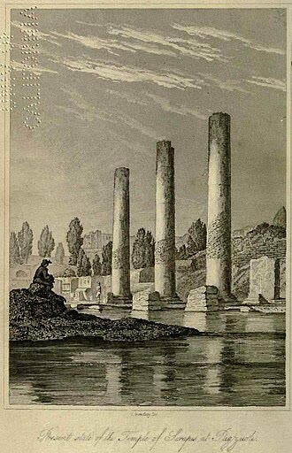
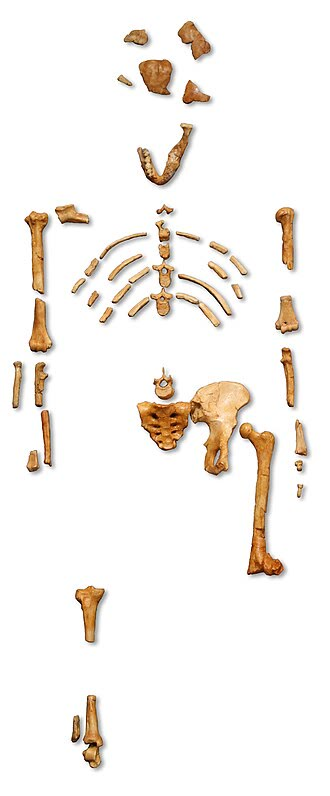

+++
title = 'Starost Zemlje: rođenje geologije'
date = 2024-11-11T18:40:03+01:00
draft = false
tags = ['povijest']
series = 'Umjetnost na stijenama'
thumbnail = 'apr2015_h07_chauvetcave.webp'
+++

Priča o starosti Zemlje fascinantno je putovanje kroz vrijeme u kojem se isprepliću mitologija, znanstveno istraživanje i revolucionarne ideje. Počinje s **Jamesom Ussherom** (1581.–1656.), irskim nadbiskupom iz 17. stoljeća. Oslanjajući se na Bibliju kao glavni izvor, izračunao je da je svijet stvoren **4004. godine pr. Kr.** i to objavio u svojim _Analima_ 1650-ih.[^1] U to su vrijeme mitološki i religijski tekstovi bili mjerodavni vodiči kroz povijest svijeta. Isto je vrijedilo i u islamskom svijetu, gdje je Kuran bio glavni izvor o podrijetlu čovjeka. Ussherov je zaključak bio široko prihvaćen.

> Prema Ussheru, stvaranje svemira dogodilo se „na početku noći koja je prethodila 23. listopada… godine 4004. prije Krista”
{caption="— James Ussher"}

Vrijedi zapamtiti da taj datum nije samo zanimljivost. Pokazuje koliko su se Europljani nekoć potpuno oslanjali na Sveto pismo kad je riječ o podrijetlu čovječanstva. Velik dio onoga što slijedi priča je o tome kako je to oslanjanje ustuknulo pred dokazima. To je ujedno i pozadina koja vam treba ako želite razumjeti zašto su [umjetnost na stijenama](/posts/south-african-rock-art) i umovi koji su je stvorili toliko važni za proučavanje religije.

### Od mitologije prema znanosti

Znanstvena revolucija postupno je oslabila stisak Svetog pisma nad prirodoslovljem. **Newton** je objasnio gibanje planeta, a **Galileo** je teleskopom pokazao da Zemlja nije središte svemira. Neki su mislioci počeli na isti način istraživati i tlo pod svojim nogama.

Pojavile su se tri suprotstavljene slike. **Katastrofizam** je tvrdio da su obilježja Zemlje nastala naglim, nasilnim događajima, ponajprije **Noinim potopom**. Slojevi u stijenama tumačili su se kao talog koji se slegnuo iz vode potopa, a kanjoni kao korita koja je izdubila nabujala voda. **Gradualizam** i **uniformitarizam** smatrali su da mali, spori procesi, koji djeluju i danas, tijekom dugih razdoblja dovode do velikih promjena.

Ključna je osoba ovdje **James Hutton**, škotski geolog s kraja 18. stoljeća. Njegova _Teorija Zemlje_ (_Theory of the Earth; or an Investigation of the Laws Observable in the Composition, Dissolution, and Restoration of Land upon the Globe_) objavljena je 1788. u časopisu _Transactions of the Royal Society of Edinburgh_.[^2] U njoj je tvrdio da je Zemlja mnogo starija nego što su dopuštali doslovni tumači Biblije. Hutton je u stijenama vidio dugi ciklus erozije, taloženja i izdizanja u kojem, kako je slavno rekao, nema „ni traga početku, ni izgleda kraju”. Prema Huttonu, sadašnjost je ključ za razumijevanje prošlosti. Ta je ideja potkopala prevladavajuću biblijsku kronologiju i postavila temelje moderne geologije.

Bilo bi mi drago da odvojite vrijeme i pogledate ovaj video:



Nisu se svi rani geolozi slagali. Katastrofizam, sa svojom geologijom potopa, još je neko vrijeme ostao popularan. Upravo je **Charles Lyell**, engleski geolog, od Huttonovih ideja stvorio stručnu znanost. Njegova _Načela geologije_ (_Principles of Geology_, 1830.–1833.)[^3] nosila su dugačak podnaslov koji sažima cijeli program: pokušaj da se nekadašnje promjene Zemljine površine objasne uzrocima koji djeluju i danas. Proučavao je vulkan Etnu, gdje je vidio kako su tokovi lave sloj po sloj izgradili planinu.

### Serapisov hram

Na naslovnoj ilustraciji Lyellove knjige tri stupa stoje u vodi. Pripadaju takozvanom **Serapisovu hramu** (zapravo rimskoj tržnici) u **Pozzuoliju** u Napuljskom zaljevu. Stupove su izbušili morski školjkaši, koji su na određenoj visini ostavili pojas rupa. Hram je, dakle, morao biti sagrađen na kopnu, zatim potonuti ispod mora dovoljno dugo da školjkaši obave svoje, a onda se ponovno izdići. Lyell je to uzeo kao dokaz da se samo tlo diže i spušta, postupno i još i danas. Bio je to odlučan udarac ideji o nepromjenjivoj Zemlji.

Lyell je promatrao i kako se talog nakuplja danas, a zatim razmotrio koliko ga sadrže slojevi stijena diljem svijeta. Gruba procjena daje Zemlji starost od milijuna godina. Upravo je toliko vremena trebalo **Darwinu**, koji je _Načela_ čitao na svojem putovanju, da bi evolucija mogla djelovati.

### Charles Darwin i evolucija

U 19. stoljeću rad **Charlesa Darwina** dodao je novi sloj razumijevanju povijesti Zemlje. Darwinova temeljna knjiga _Postanak vrsta_ (_On the Origin of Species_, 1859.)[^4] predstavila je teoriju evolucije prirodnim odabirom. Na putovanju oko svijeta brodom **HMS Beagle** primijetio je da se srodne vrste razlikuju na načine koji odgovaraju njihovu okolišu. Zebe s Galápagosa imaju kljunove prilagođene prehrani. Divovske kornjače razlikuju se oblikom oklopa od otoka do otoka: one sa sedlastim oklopom žive na suhim otocima, gdje hrana visi visoko, a one s kupolastim oklopom ondje gdje trave ima u izobilju.

Darwin je pomno proučavao i pripitomljavanje. Golubovi, psi, goveda i usjevi golemo su se promijenili pod ljudskim uzgojem. Ako umjetni odabir od pretka nalik vuku može stvoriti mopsa, pitao se, što tek može priroda kad ima dovoljno vremena? Duga povijest Zemlje bila je sastojak koji je nedostajao, a pružio ga je Lyell. Popularni izraz „opstanak najsposobnijih” često se pogrešno shvaća. Skovao ga je filozof **Herbert Spencer**, a Darwin ga je preuzeo u kasnijim izdanjima. Ne znači najjači ili najbrži, nego onaj koji najbolje odgovara određenom okolišu.

Darwinove ideje bile su kontroverzne, osobito kad je riječ o evoluciji čovjeka. S nekima se mučio i sam Darwin; 1860. napisao je botaničaru **Asi Grayu**: _„Pogled na pero paunova repa, kad god ga promatram, izaziva mi mučninu!”_[^5] Rep ga je mučio jer ga prirodni odabir sam nije mogao objasniti. Odgovor je u djelu _Podrijetlo čovjeka_ (_The Descent of Man_, 1871.) pronašao u **spolnom odabiru**: osobine poput paunova raskošnog repa razvijaju se jer privlače partnere, čak i ako izravno ne pomažu preživljavanju.

### Rasprava u Oxfordu

Napetost je kulminirala u lipnju 1860. na skupu Britanskog udruženja za napredak znanosti u Oxfordu. Biskup **Samuel Wilberforce** navodno je upitao **Thomasa Huxleyja** potječe li od majmuna po djedu ili po baki. Huxley je navodno odgovorio da bi radije imao majmuna za pretka nego čovjeka koji svoje darove koristi da bi ozbiljnu znanstvenu raspravu izvrgnuo ruglu. Doslovni zapis nije sačuvan, a izvještaji se razlikuju, pa točne riječi nisu poznate.[^6] Pamti se i da je **Robert FitzRoy**, kapetan Beaglea i duboko religiozan čovjek, prosvjedovao podižući Bibliju. Pet godina poslije, 1865., oduzeo si je život.

### Otkriće drevnih dokaza

Dokazi o dubokoj starosti čovječanstva nakupljali su se u isto vrijeme. Godine 1856. radnici su u dolini Neander u Njemačkoj pronašli kostur u kojem je **Johann Carl Fuhlrott** prepoznao zasebnu, snažnu i arhaičnu vrstu čovjeka, s izraženim nadočnim lukovima i velikim nosom. Bio je to **neandertalac**, koji je oblikovao popularnu predodžbu o „špiljskom čovjeku”. Godine 1899. novi su **neandertalski fosili** pronađeni na **Hušnjakovu brdu** kod Krapine, gdje ih je iskopavao **Dragutin Gorjanović-Kramberger**.[^7]

Oko 1860. francuski paleontolog **Édouard Lartet** pronašao je kosti izumrlih životinja iz ledenog doba u koje su ljudske ruke urezale crteže. To je pokazalo da su ljudi živjeli uz mamute i runaste nosoroge. Zatim je 1879. **Marcelino Sanz de Sautuola** uočio oslikane bizone na stropu **špilje Altamira** u Španjolskoj. Kaže se da ih je prva primijetila njegova kći María.[^8] Njegovo je otkriće dočekano sa sumnjom, a mnogi su ga stručnjaci optužili za krivotvorinu. Opravdan je tek nakon smrti, kad su slične špilje pronađene u Francuskoj. Te su slike — primjer [umjetnosti na stijenama](/posts/south-african-rock-art) — među najranijim poznatim primjerima ljudske kreativnosti i pokazuju koliko je duboka naša povijest.

To je bilo i doba kolonijalnog širenja. Europljani su susretali žive zajednice lovaca i sakupljača, poput naroda San u Kalahariju, američkih starosjedilaca i australskih Aboridžina. Mnogi su ih smatrali preživjelim ostacima **iskonskog stanja** čovječanstva. Takav je pogled često bio pokroviteljski i pogrešan, ali je oblikovao predodžbu o prapovijesti. Sani su danas poznatiji po bogatstvu duhovnog života i [umjetnosti na stijenama povezanoj s transom](/posts/between-worlds), te po tome kako se ta umjetnost čita kao prozor u rane [religije i obrede](/posts/south-african-rock-art).

### Razvoj znanstvenih metoda datiranja

Radioaktivnost je napokon omogućila mjerenje dubokog vremena. Godine 1907. **Bertram Boltwood** pokazao je da se uranij raspada u olovo i taj je omjer upotrijebio za datiranje stijena, a **Arthur Holmes** razvio je metodu sljedećih godina. **Uranij-238** raspada se u **olovo-206** s vremenom poluraspada od oko 4,47 milijardi godina, a **uranij-235** u **olovo-207** s vremenom poluraspada od oko 704 milijuna godina. Omjer izvornih i nastalih atoma u mineralu daje njegovu starost. Kristali cirkona idealni su jer pri nastanku primaju uranij, ali ne i olovo.

Godine 2001. cirkoni iz **Jack Hillsa** u Zapadnoj Australiji datirani su na do oko 4,4 milijarde godina, što ih čini najstarijim poznatim ulomcima Zemljine kore.[^9] Starost same Zemlje, oko 4,54 milijarde godina, utvrdio je **Clair Patterson** 1956. iz izotopa olova u meteoritima. Ta su mjerenja potvrdila ono što su Hutton i Lyell tvrdili na temelju stijena: planet je nezamislivo stariji nego što dopušta biblijska kronologija.

Fosilni zapis počeo je otkrivati i naše pretke. **Lucy**, pripadnica vrste **Australopithecus afarensis** koju je 1974. u Etiopiji pronašao **Donald Johanson** sa svojim timom, živjela je prije otprilike 3,2 milijuna godina.[^10] Lubanja i mozak bili su joj nalik majmunskima, ali zdjelica i noge pokazuju da je hodala uspravno. Hodanje na dvije noge, dakle, prethodilo je velikom mozgu, suprotno onome što su mnogi očekivali. Otada je pronađeno još mnogo vrsta, među njima _Homo habilis_, rani izrađivač oruđa, i _Homo erectus_, povezan s ranim dokazima o uporabi vatre, kao i neandertalci i naša vrsta, _Homo sapiens_.

### Zaključak

Proučavanje starosti Zemlje iz temelja je promijenilo naše razumijevanje planeta i našeg mjesta na njemu. Od Ussherove biblijske kronologije do znanstvenih otkrića Huttona, Lyella, Darwina i drugih, geologija je izrasla u strogu znanost. Dokazi o drevnoj Zemlji danas su nepobitni, a svako novo otkriće — bilo da je riječ o fosilima, drevnim špiljskim slikama ili naprednim metodama datiranja — dodatno produbljuje naše razumijevanje duge i složene povijesti Zemlje.

Znanost ipak nije uklonila potrebu za pričama o podrijetlu. Gdje je srednjovjekovna Europa imala Knjigu postanka, današnja se mašta često okreće filmovima o izvanzemaljcima koji su posijali život. Razumjeti religiju i mitologiju znači ozbiljno shvatiti i fizičke dokaze o našem podrijetlu i priče koje ljudi o njemu pričaju.

[^1]: James Ussher, _Annales veteris testamenti_ (1650.); vidi [Ussher chronology](https://en.wikipedia.org/wiki/Ussher_chronology), Wikipedia.
[^2]: James Hutton, „Theory of the Earth; or an Investigation of the Laws Observable in the Composition, Dissolution, and Restoration of Land upon the Globe”, _Transactions of the Royal Society of Edinburgh_, sv. 1 (1788.). Vidi [James Hutton](https://en.wikipedia.org/wiki/James_Hutton), Wikipedia.
[^3]: Lyellova _Načela geologije_ (1830.–1833.) zagovarala su uniformitarizam: obilježja Zemlje oblikovali su postupni, neprekidni procesi, a ne katastrofalni događaji. Vidi [Principles of Geology](https://en.wikipedia.org/wiki/Principles_of_Geology), Wikipedia.
[^4]: Freeman, R. B. (2007). [_Charles Darwin: A companion_](http://darwin-online.org.uk/content/frameset?itemID=A27b&viewtype=text&pageseq=114) (2. mrežno izd.). [The Complete Works of Charles Darwin Online](https://en.wikipedia.org/wiki/The_Complete_Works_of_Charles_Darwin_Online "The Complete Works of Charles Darwin Online"). str. 107, 109. [Arhivirano](https://web.archive.org/web/20141225163344/http://darwin-online.org.uk/content/frameset?itemID=A27b&viewtype=text&pageseq=114) 25. prosinca 2014. Pristupljeno 25. prosinca 2014.
[^5]: Pismo Charlesa Darwina Asi Grayu, 3. travnja 1860., Darwin Correspondence Project. Vidi [Darwin Correspondence Project](https://www.darwinproject.ac.uk/).
[^6]: Vidi [1860 Oxford evolution debate](https://en.wikipedia.org/wiki/1860_Oxford_evolution_debate), Wikipedia.
[^7]: Vidi [Krapina Neanderthal site](https://en.wikipedia.org/wiki/Krapina_Neanderthal_site), Wikipedia.
[^8]: Vidi [Cave of Altamira](https://en.wikipedia.org/wiki/Cave_of_Altamira), Wikipedia.
[^9]: Wilde, S. A. i sur., „Evidence from detrital zircons for the existence of continental crust and oceans on the Earth 4.4 Gyr ago”, _Nature_ 409 (2001.). Vidi [Jack Hills](https://en.wikipedia.org/wiki/Jack_Hills), Wikipedia.
[^10]: Vidi [Lucy (Australopithecus)](https://en.wikipedia.org/wiki/Lucy_(Australopithecus)), Wikipedia.
