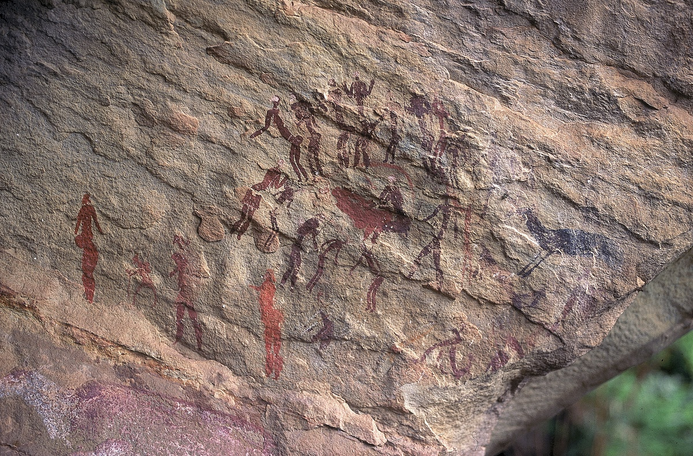

+++
title = 'Između svjetova: trans kod šamana naroda San'
date = 2024-11-11T22:57:42+01:00
draft = false
tags = ['povijest', 'trans']
series = 'Umjetnost na stijenama'
thumbnail = 'trance-dance.jpg'
+++

Da bi ušao u svijet duhova, šaman mora izazvati trans, i to lovom na duha zaštitnika ili životinju moći. Tu ulogu često ima antilopa eland. Njezina se mast simbolično koristi u mnogim ritualima, uključujući inicijacije i obrede prijelaza. Istu ulogu mogu imati i druge životinje, poput žirafe, kudua i buvolje antilope.

Jedan od najvažnijih rituala u religiji naroda San jest veliki ples, odnosno ples transa. Obično se izvodi u krugu: žene plješću i pjevaju, a muškarci ritmično plešu. Iako nema dokaza da Sani iz Kalaharija redovito koriste halucinogene, šaman u obuci može ih upotrijebiti kako bi prvi put ušao u trans.

Sve to poznajemo neobično detaljno. U 19. stoljeću muškarci iz naroda /Xam objasnili su svoja vjerovanja, i kopije slika, jezikoslovcima koji su ih zapisali, o čemu pišem u članku [Oslikane vizije](/posts/south-african-rock-art). Kasnija terenska istraživanja među Sanima u Kalahariju popunila su ostatak.[^1] Zajedno nam omogućuju da pratimo šamana od ruba vatre u svijet duhova i natrag.

### Moć: riječ iza „čarobnjaka”

Lucy Lloyd prevela je riječ iz jezika /Xam kao „čarobnjak”, ali ideja je suptilnija. **!gi** znači nadnaravnu moć: nevidljivu bit koja živi u moćnim životinjama, u stvarima i ponajprije u određenim ljudima, **!gi:ten**. Oni je mogu upotrijebiti za dobro ili za zlo. Kod naroda Ju/'hoansi u Kalahariju odgovarajući je pojam **n/om**, a iscjelitelj je vlasnik n/oma. Govori se o moći žirafe, moći meda, moći sunca i, najpoželjnijoj od svih, moći elanda.[^1] Riječ „lijek” u smislu u kojem je koriste američki starosjedioci (_medicine_) bliža je od „čarobnjaka”. Znači moć, a ne tabletu.

### Ples

Plesom se moć pokreće. U središtu gori vatra, a oštro, ritmično pljeskanje žena i „ljekovite pjesme” zagrijavaju moć dok ne „proključa” uz plesačevu kralježnicu. Mrtvi lebde iza ruba svjetla vatre i odapinju „strijele bolesti” na žive. Iscjelitelji polažu ruke na bolesne, uvlače bolest u vlastito tijelo i izbacuju je kroz otvor na zatiljku.[^1]

**Qing**, muškarac iz naroda San koji je 1873. vodio magistrata **Josepha Millarda Orpena** kroz planine Maloti, opisao je ples istim riječima: muškarci i žene cijelu noć plešu u krugu, neki padaju, neki se ponašaju kao da su ludi ili bolesni, a drugima curi krv iz nosa. Kad bi se netko razbolio, plesači bi mu pritiskali ruke pod pazuhe dok ne bi iskašljao ono što ga je boljelo.[^2]

### Što šaman doživljava

U dubokom transu šaman drhti, može se ukočiti i pasti, a kaže da mu duh izlazi kroz otvor na tjemenu. Putuje izvan tijela da bi susreo duhove i mrtve, zbog čega se kaže da je šaman „umro”.[^1] Krvavi nosovi, znoj, ljudi s glavom antilope i položaj nagnut naprijed pojavljuju se na slikama iz Drakensberga, i upravo po tome istraživači povezuju slike s tim svjedočanstvima.

Ideja o duši koja izlazi kroz tjeme pojavljuje se i drugdje. Hinduistički tekstovi govore o **brahmarandhri**, otvoru na vrhu lubanje. Tibetanska budistička praksa _phowa_ nastoji u trenutku smrti tim putem otpremiti svijest. Robert L. Hall prikupio je usporedbe kod američkih starosjedilaca: Hopiji su meko mjesto na dječjoj glavi, fontanelu, nazivali _kopavi_, „otvorena vrata”, a Shawneeji su vjerovali da kroz nju duša ulazi u nerođeno dijete.[^3] Te su usporedbe poticajne, ali ništa više od toga. Pokazuju da se ista tjelesna slika ponavlja, a ne da te tradicije imaju zajedničko podrijetlo.

### Tri faze transa

Neuropsihološki model koji su razvili **David Lewis-Williams** i **Thomas Dowson** bio je utjecajan, ali i kontroverzan.[^4] Psiholozi su u okviru neuropsihologije proučavali halucinacije i izmijenjena stanja svijesti. Utvrdili su da entoptičke pojave mogu izazvati ritmičan ples, glazba, osjetilna deprivacija, hiperventilacija, dugotrajna i snažna koncentracija te migrene. Model objašnjava umjetnost na stijenama kroz tri faze transa.

U prvoj fazi nastupa izmijenjeno stanje svijesti i ljudi vide geometrijske oblike poznate kao entoptičke pojave: cik-cak linije, ševrone, točke, mrlje, mreže, vrtloge i oblike slova U. Takvi se oblici osobito često pojavljuju u gravurama na stijenama južne Afrike.

U drugoj fazi transa ljudi pokušavaju dati smisao entoptičkim pojavama. Oblike koje su „vidjeli” razrađuju sve dok ne nalikuju nečemu poznatom. Šamani u drugoj fazi u te vizije unose prirodni svijet pa vide, primjerice, saće ili druge poznate oblike.

U trećoj fazi osobu uvlači vrtlog ili tunel koji se okreće. Geometrijski oblici i živopisne halucinacije sada se miješaju, a osoba može osjetiti da se pretvara u životinju ili pticu. Upravo tu fazu, čini se, bilježe slikari terijantropa, likova napola ljudi, napola životinja.

Kritičari prigovaraju da je model izgrađen na južnoafričkim dokazima, a zatim primijenjen na europske špilje, te da svaki prikaz može pretvoriti u viziju. Tom se pitanju vraćam na kraju članka [Oslikane vizije](/posts/south-african-rock-art). Dokazi o narodu San najbolje su dokumentiran slučaj, i ideja da je velik dio njihove umjetnosti povezan s transom ondje se održala bolje nego igdje drugdje.

### Zaključak

Trans šamana naroda San pruža nam nešto rijetko: opis izmijenjenih stanja iznutra, iz tradicije koja ih je i slikala. Moć, ples, putovanje kroz tjeme i iscjeljivanje po povratku slažu se u jednu cjelinu, a slike na stijenama prikazuju njezine dijelove. To je promijenilo pitanje koje postavljamo umjetnosti na stijenama: umjesto „što prikazuju ove slike?” pitamo „što su njihovi autori doživljavali?”

[^1]: David Lewis-Williams i Sam Challis, _Deciphering Ancient Minds: The Mystery of San Bushman Rock Art_ (Thames & Hudson, 2011.).
[^2]: Joseph M. Orpen, „A Glimpse into the Mythology of the Maluti Bushmen”, _Cape Monthly Magazine_ (1874.).
[^3]: Robert L. Hall, _An Archaeology of the Soul: North American Indian Belief and Ritual_ (University of Illinois Press, 1997.).
[^4]: J. D. Lewis-Williams i T. A. Dowson, „The Signs of All Times: Entoptic Phenomena in Upper Palaeolithic Art”, _Current Anthropology_ 29 (1988.), str. 201–245.
