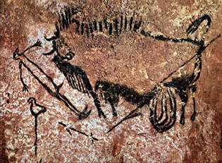

+++
title = 'Oslikane vizije: kako čitati umjetnost naroda San na stijenama'
date = 2024-11-11T20:00:00+01:00
draft = false
tags = ['povijest', 'trans']
series = 'Umjetnost na stijenama'
thumbnail = 'The-Sorcerer.jpg'
+++

Južna Afrika čuva jednu od najbogatijih zbirki umjetnosti na stijenama na svijetu. Desetci tisuća slika i gravura sačuvani su u stjenovitim zaklonima i na otvorenim gromadama, od gorja Cederberg na zapadu do Drakensberga na istoku. Većinu su ih izradili preci naroda San, lovaca i sakupljača koji u tom području žive tisućama godina.

Te su slike važne i izvan južne Afrike. Dugo nitko nigdje nije znao kako čitati umjetnost na stijenama. Tradicija naroda San neobična je jer je u 19. stoljeću nekolicina Sana detaljno objasnila što takvi prikazi znače, a netko je to zapisao.

## Koliko je stara?

Ta tradicija seže duboko u prošlost. Komad okera s urezanim mrežastim uzorkom iz **špilje Blombos** na južnoj obali Rta star je oko 75 000 godina, a oslikane kamene ploče iz **špilje Apollo 11** u susjednoj Namibiji stare su oko 27 000 godina. Ipak, većina slika koje danas možemo vidjeti mnogo je mlađa — najveći dio nastao je u posljednjih nekoliko tisuća godina, a neke prikazuju konje, zaprežna kola i ljude s puškama, što znači da su naslikane nakon dolaska europskih doseljenika.

Samo **park uKhahlamba-Drakensberg**, upisan na UNESCO-ov popis svjetske baštine, ima oko 600 nalazišta s više od 35 000 pojedinačnih prikaza. Slikari su za crvene i žute tonove koristili oker, za crnu ugljen i mangan, a za bijelu bijelu glinu, miješajući ih s vezivima poput životinjske masti ili krvi.

## Što prikazuju slike?

Na prvi pogled velik dio te umjetnosti djeluje kao zapis svakodnevnog života: lovci s lukovima, skupine plesača i, iznad svega, životinje. **Eland**, najveća afrička antilopa, naslikan je češće i detaljnije od bilo koje druge životinje. Znanstvenici su te prikaze dugo tumačili kao jednostavne prizore lova i prehrane.

To se promijenilo 1970-ih i 1980-ih, kada je arheolog **David Lewis-Williams** usporedio slike sa svjedočanstvima pripadnika naroda /Xam zabilježenima u 19. stoljeću te s iskazima Sana koji žive u Kalahariju. Zaključio je da je velik dio te umjetnosti religijski: prikazuje ono što su šamani proživljavali u transu, kada su ulazili u svijet duhova kako bi liječili bolesne, prizivali kišu i upravljali divljači.[^1]

## Njihovim riječima

Ta svjedočanstva iz 19. stoljeća postoje zahvaljujući njemačkom filologu **Wilhelmu Bleeku**, koji je 1855. stigao na Rt kako bi proučavao bantu jezike, a umjesto toga posvetio se jezicima naroda San, punima coktavih suglasnika ili klikova. On i njegova šogorica **Lucy Lloyd**, kojima se poslije pridružila i njegova kći **Dorothea Bleek**, radili su s muškarcima iz naroda /Xam koji su bili zatočeni u Cape Townu, a zatim smješteni u Bleekovu kućanstvu. Među njima su bili **Diä!kwain** i **//Kabbo**, čije riječi ispunjavaju tisuće stranica.[^2]

")

Kopije slika na stijenama koje su izradili istraživači amateri poput **Josepha Millarda Orpena** i **Georgea Williama Stowa** pokazivane su kazivačima, a oni su ih objašnjavali. Lucy Lloyd zapisala je kako Diä!kwain promatra niz plesačkih likova:

> Čini se da plešu, jer stoje i udaraju (?) nogama. Ovaj čovjek koji stoji sprijeda kao da pokazuje ljudima kako se pleše.
{caption="— Diä!kwain, zabilježila Lucy Lloyd 1875."}

Dodao je da predvodnik pleše prvi jer je velik čarobnjak, a da oni koji uče plešu za njim.[^3] Riječ koju je Lloyd zapisala kao „čarobnjak” zapravo označava vlasnika nadnaravne moći, a ples je ples transa. Oboje pratim u članku [Između svjetova](/posts/between-worlds).

Arhiv ima i tužnu pozadinu. Kolonisti su u 19. stoljeću protjerali Sane iz Drakensberga, i ondje je tradicija slikanja na stijenama zamrla. Zajednice naroda San opstale su u Kalahariju, ali ne slikaju po stjenovitim zaklonima. Ti su zapisi stoga jedan od rijetkih preostalih načina da čujemo potomke slikara.

## Čitanje slika

Kad se slike čitaju uz te zapise, detalji koji su se činili čudnima dobivaju smisao. Plesači su nagnuti naprijed s rukama ispruženima iza tijela, u položaju koji se i danas koristi u plesovima transa. Likovima krvari nos, kao i plesačima u dubokom transu. Jedan lik ima glavu elanda i krvav nos, s crtama koje bi mogle biti znoj iz pazuha, kojim su iscjelitelji trljali bolesne. Drugome bolest izlazi iz zatiljka, što su mogli vidjeti samo šamani. Umirući elandi, koje su Sani povezivali sa snažnom duhovnom moći, pojavljuju se uz ljude koji dijele njihova obilježja.

## Napola čovjek, napola životinja

Neki od najupečatljivijih likova su **terijantropi**: bića koja su djelomično ljudi, a djelomično životinje. U zaklonu **Game Pass** u Drakensbergu umirući eland posrće prekriženih nogu, a lik koji ga drži za rep umjesto stopala ima kopita. Taj je prizor toliko važan za tumačenje transa da ga često nazivaju „kamenom iz Rosette” umjetnosti naroda San: šaman, poput umirućeg elanda, ulazi u drugi svijet.

Slični likovi pojavljuju se u gornjopaleolitičkim špiljama Europe, koje su desetcima tisuća godina ranije izradili ljudi bez ikakva dodira s južnom Afrikom.

Najpoznatiji je „Čarobnjak” iz špilje Trois-Frères u Francuskoj, lik s rogovima, licem nalik sovi i ljudskim nogama. Prikazuju li takvi likovi šamane, duhove ili nešto sasvim drugo, i dalje je predmet rasprave, no ta usporedba upućuje na to da je dio onoga što vidimo u umjetnosti na stijenama ukorijenjen u ljudskom iskustvu zajedničkom svim kontinentima.

## Od Drakensberga do prvih hramova

Ako ključ koji su nam ostavili Sani vrijedi u južnoj Africi, dokle može dosegnuti? Najneobičniji je ispit prizor iz Okna u špilji **Lascaux** u Francuskoj, naslikan prije otprilike 17 000 godina u dubokom, teško dostupnom udubljenju špilje. Bizon stoji rasporena trbuha iz kojeg vise utrobe. Pred njim leži, ili pada, ukočen čovjek s ptičjom glavom. Pokraj njega je ptica na vrhu motke. Ljudski su likovi rijetki u paleolitičkoj špiljskoj umjetnosti, pa je ovaj tim zagonetniji.[^4]

Prevladavaju dva tumačenja. Prema jednom to je prizor lova u kojem je čovjek ranio bizona i stradao od njegovih rogova. Drugo, koje seže do **Henrija Breuila**, a poslije ga je popularizirao **Joseph Campbell**, u njemu vidi šamana u transu, a pticu na motki kao duha pomagača. Pročitan s narodom San na umu, ukočeni lik koji je „umro” pokraj umiruće životinje djeluje vrlo poznato.

Isto se pitanje proteže i na arhitekturu. **Göbekli Tepe** u jugoistočnoj Turskoj, koji je od 1995. iskopavao njemački arheolog **Klaus Schmidt**, skup je prstenastih konstrukcija s monolitnim vapnenačkim stupovima u obliku slova T. Podignuli su ih oko 9500. pr. Kr. ljudi koji se, koliko znamo, još nisu bavili poljodjelstvom.[^5] Na stupovima su uklesane lisice, zmije i strvinari, a dva visoka središnja stupa u prstenu D imaju ruke, šake i pojas, pa se tumače kao stilizirani ljudski, možda pradjedovski ili božanski likovi. Nalazište je oko 7000 godina starije od Velike piramide.

Starija priča glasila je da je poljodjelstvo bilo prvo, a da su spomenici i organizirana religija proizašli iz viškova stalnih naselja. Göbekli Tepe dovodi taj redoslijed u pitanje: neki od najranijih oblika suradnje velikih razmjera koje možemo vidjeti bili su usmjereni prema nevidljivom svijetu, a ne prema kućama ili obrani.

Ipak je potreban oprez. Sačuvane slike naroda San mnogo su mlađe od Lascauxa, a nitko ne zna što se točno zbivalo na Göbekli Tepeu. Ta je usporedba argument, a ne dokaz. No dobar ključ ne mora biti savršen da bi promijenio ono što vidimo, a zapisi naroda San najbolji su ključ koji umjetnost na stijenama ima. O dugom putu do prihvaćanja tako dubokog vremena pišem u članku [Starost Zemlje](/posts/age-of-earth).

## Zaključak

Umjetnost naroda San jedna je od najdugovječnijih umjetničkih tradicija koje je čovječanstvo stvorilo i jedna od rijetkih čije su značenje još mogli objasniti potomci samih umjetnika. Upravo je to čini toliko vrijednom. Bez tih zapisa bi eland, krvavi nosovi i lik s kopitima iz zaklona Game Pass bili prikazi o kojima bismo mogli samo nagađati. S njima postaju zapisi o plesu, o moći i o putovanju u svijet duhova. A kad ih jednom naučimo čitati, teško je na čovjeka s ptičjom glavom iz Lascauxa ili na uklesane stupove Göbekli Tepea gledati na isti način.

Same su slike krhke. Blijede na suncu, ispire ih kiša, a oštećuju ih i posjetitelji koji ih vlaže kako bi boje izgledale jarkije. Ako posjetite neko nalazište, gledajte i fotografirajte — ali nikada ne dirajte.

[^1]: David Lewis-Williams i Sam Challis, _Deciphering Ancient Minds: The Mystery of San Bushman Rock Art_ (Thames & Hudson, 2011.).
[^2]: „Wilhelm Bleek”, Wikipedia, [en.wikipedia.org/wiki/Wilhelm_Bleek](https://en.wikipedia.org/wiki/Wilhelm_Bleek); zbirku Bleek i Lloyd digitaliziralo je Sveučilište u Cape Townu na [digitalbleeklloyd.uct.ac.za](https://digitalbleeklloyd.uct.ac.za/).
[^3]: Diä!kwain je 1875. komentirao kopije koje je izradio George William Stow; Lucy Lloyd zapisala je njegove riječi na engleskom, a upitnik u zagradi njezin je, jer nije bila sigurna u riječ _stamping_. Citat je prijevod autora s tog engleskog zapisa. Vidi Lewis-Williams i Challis, _Deciphering Ancient Minds_.
[^4]: „Lascaux”, Wikipedia, [en.wikipedia.org/wiki/Lascaux](https://en.wikipedia.org/wiki/Lascaux).
[^5]: Klaus Schmidt, _Göbekli Tepe: A Stone Age Sanctuary in South-Eastern Anatolia_ (2012.); vidi i „Göbekli Tepe”, Wikipedia, [en.wikipedia.org/wiki/Göbekli_Tepe](https://en.wikipedia.org/wiki/G%C3%B6bekli_Tepe).
